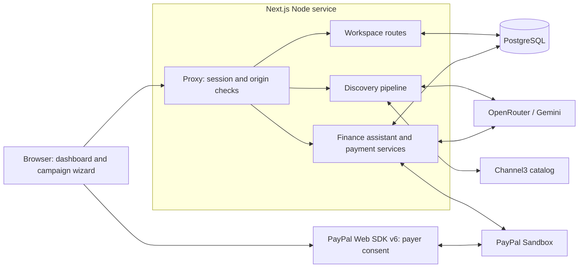

# Prova

Prova helps relief teams plan supply purchases, approve PayPal Sandbox payments, request sponsor funding, and track refunds. Product search uses Channel3; retailer fulfillment is simulated.

## System architecture

The app is a Next.js 16 App Router application with React 19 and PostgreSQL. The dashboard and campaign wizard use a React context store; authenticated API routes own database updates and provider calls. Agents run inside those requests. There is no separate worker service.

The [Render Blueprint](render.yaml) provisions the Node web service and managed PostgreSQL in Ohio, connected through an internal `DATABASE_URL`. Its pre-deploy command applies migrations and seeds an empty workspace. Credentials stay on the server; the browser receives the public PayPal client ID.

### Code map

| Area | Start here | Responsibility |
| --- | --- | --- |
| Pages and layout | [`app/`](app), [`components/`](components) | Landing page, login, dashboard, campaign wizard, and campaign detail views. |
| Browser state | [`lib/store.tsx`](lib/store.tsx), [`lib/types.ts`](lib/types.ts) | Loads the shared workspace, queues browser saves, and retries failed saves. |
| Authentication | [`proxy.ts`](proxy.ts), [`lib/server/session.ts`](lib/server/session.ts) | Checks signed sessions and mutation origins. Login and logout live in `app/api/auth/`. |
| Persistence | [`lib/server/workspace.ts`](lib/server/workspace.ts), [`lib/server/db.ts`](lib/server/db.ts) | Validates edits, locks records, checks versions, and commits transactions. |
| Supply discovery | [`lib/server/discovery.ts`](lib/server/discovery.ts) | Calls models and Channel3, validates product references, and signs proposals. |
| Budget math | [`lib/money.ts`](lib/money.ts), [`lib/server/budget-allocation.ts`](lib/server/budget-allocation.ts) | Calculates USD cents, estimated charges, and affordable quantities. |
| Checkout and saved wallets | [`lib/server/checkout.ts`](lib/server/checkout.ts), [`lib/server/vault.ts`](lib/server/vault.ts) | Creates and captures orders, verifies receipts, and manages saved PayPal tokens. |
| Campaign finance | [`lib/server/finance-agent.ts`](lib/server/finance-agent.ts), [`lib/server/finance.ts`](lib/server/finance.ts) | Provides assistant tools, prepares review cards, and confirms invoices or refunds. |
| Database setup | [`db/migrations/`](db/migrations), [`db/seed.ts`](db/seed.ts), [`scripts/`](scripts) | Schema migrations, sample campaigns, wallet bootstrap, and explicit demo reset. |

### Workspace and authentication

PostgreSQL stores one shared workspace:

- `workspace`: organization settings, folders, a version number, and an encrypted saved-wallet reference.
- `campaigns`: campaign JSON documents and version numbers. Documents include proposals, purchases, finance messages, operations, invoices, refunds, and audit entries. Deletion hides a campaign while retaining payment records for recovery.
- `payment_attempts`: one checkout attempt per campaign, including its stable request ID, pending payment ticket, and completion flag.

Browser workspace edits go through `/api/workspace`. Campaign and settings edits carry version numbers; stale edits are rejected and the browser reloads the workspace. Server payment routes load and lock the campaign in a database transaction. The browser can save finance messages and review state, while payment routes save purchases and financial results. Only the theme is stored in `localStorage`.

`DEMO_EMAIL` and `DEMO_PASSWORD` configure one shared team login. Sign-in issues a signed HttpOnly session cookie valid for 24 hours. The proxy protects dashboard, campaign, PayPal, and API routes; authentication routes are exempt from the session check. Browser mutations, including login and logout, require a matching origin. `APP_URL`, then `RENDER_EXTERNAL_URL`, then the request URL determines that origin. There are no individual accounts or organization boundaries.

### Supply discovery

`POST /api/discovery` streams newline-delimited JSON containing progress events and the final plan. The server directs the sequence:

1. **Plan searches.** The model reads the request and proposes up to six Channel3 queries. Searches run in batches of three. The server keeps priced USD offers, excludes selected department stores, and ranks preferred suppliers first. Stock depth and delivery dates remain unverified.
2. **Select products.** The model receives short candidate references and returns product choices, relative quantities, and explanations. The server resolves those references to catalog records and allows one repair attempt for an invalid initial selection.
3. **Allocate the budget.** New live proposals require at least four distinct products. Server code scales quantities and fills remaining capacity with whole units. Totals use integer cents, with estimated shipping of 5% and tax of 8% of merchandise. A signed price snapshot binds the catalog records and budget for 24 hours.
4. **Handle revisions.** The server verifies the previous snapshot, then applies explicit add, update, or remove operations. Unrelated items keep their quantities. Revisions must fit the budget and are not automatically rebalanced.

If both model providers fail, initial discovery can return a clearly labeled mock plan from [`mock-plan.ts`](lib/server/mock-plan.ts). Failed AI revisions retain the existing plan and disclose that the changes were not applied. The mock flag follows a proposal into checkout and receipts. Invalid input, catalog failures, and budget errors return errors rather than silently becoming mock plans.

### Finance assistant and confirmation

`POST /api/finance/chat` runs a model-directed tool loop, limited to four model rounds and eight tool executions per message. It exposes six application functions:

| Function | Result |
| --- | --- |
| `order_status` | PayPal order, capture, and remaining refundable amount. |
| `invoice_status` | Updated campaign invoice status and received funding. |
| `refund_status` | Updated campaign refund status and amount. |
| `reconcile_campaign` | Direct order, invoice, and refund checks, plus supplementary transaction reporting. |
| `prepare_invoice` | Validated sponsor invoice review card. |
| `prepare_refund` | Validated refund review card. |

The assistant can prepare actions but cannot confirm them. Preparation returns a signed token binding the campaign, source, amount, operation ID, and invoice preferences for 15 minutes. The browser saves pending operation metadata before sending a separate confirmation request to `/api/finance`. The server revalidates the action and reuses PayPal request IDs to recover retries. Guided finance controls use the same services and remain available during model outages.

Only completed refunds reduce net campaign spending. Sponsor receipts are tracked separately and do not increase the purchasing budget. Reconciliation runs on request; there is no webhook or background synchronization.

### Model providers

Both agents start with OpenRouter and switch to Gemini after a model request exhausts its retries. Each provider request allows three attempts, waiting one and two seconds between retries. The chosen fallback remains active for the rest of that discovery run or finance message. Discovery also retries the pipeline on Gemini when OpenRouter returns unusable search planning or fails selection repair.

| Provider | Default model ID | Override |
| --- | --- | --- |
| OpenRouter | `nvidia/nemotron-3.5-super-vl:free` | `OPENROUTER_MODEL` |
| Gemini API | `gemini-3.5-flash` | `GEMINI_MODEL` |

These are application defaults, not guarantees of provider availability. Provider calls live in the discovery and finance-agent modules; retries use [`ai-retry.ts`](lib/server/ai-retry.ts).

### PayPal integration

All payment integrations target **PayPal Sandbox**:

| Integration | Used for |
| --- | --- |
| Web SDK v6 | Browser consent for one-time payments and saving a wallet. |
| Direct REST adapter | OAuth, Orders v2 creation/retrieval/capture, and Vault v3 setup/payment tokens. |
| PayPal Agent Toolkit | Finance order lookups, invoices, invoice QR codes, refunds, and transaction search. |

**Checkout.** The server reconstructs selected items from signed prices, checks the campaign's remaining funds, and commits a stable request ID before creating an order. A signed payment ticket binds the order, campaign, approved items, and exact total. Saved-wallet orders use the database's vault reference and may still require payer approval. The Web SDK opens consent; a sandbox approval URL also supports redirects and recovery.

After approval, the server retrieves the order, captures it if approved, and retrieves it again after the capture attempt, including after a timeout. It issues a receipt only for a completed order and capture matching the exact approved USD amount. Saving the receipt and completing the attempt happen in one transaction. Repeated capture requests return the saved receipt, and pending checkout data survives browser changes and server restarts.

**Saved wallets.** Vault setup uses an expiring signed ticket and browser cookie. After consent, the server verifies the approved setup token, exchanges it for a payment token, and encrypts the wallet reference in PostgreSQL and an HttpOnly cookie. Shared checkout reads the database reference. Disconnecting deletes the PayPal token and clears both references. An optional encrypted `PAYPAL_DEFAULT_VAULT_WALLET` imports a previously approved wallet once; redeploys preserve deliberate disconnects.

**Invoices and refunds.** Confirmation creates and saves an invoice draft before publication. Publication retrieves its payment link and requests a QR code; QR failures can be retried. Sponsor email is opt-in and merchant notifications are suppressed. Refunds recheck the original capture and available amount before submission, then verify the returned amount and status. Transaction Search supplements direct resource lookups because reporting can lag.

Sample campaigns contain synthetic data and cannot initiate PayPal operations. Create a new campaign to exercise sandbox payments. Database setup preserves existing edits; `db:reset` is the explicit destructive reset described in the [deployment guide](docs/render-deployment.md).

## License

[MIT](LICENSE).
