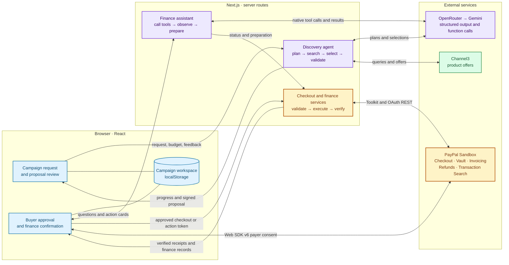

# Prova system architecture

Prova turns a disaster relief request into a priced purchasing proposal, a verified PayPal Sandbox purchase, and a campaign finance record. Two server-side agent workflows interpret requests and prepare actions. Catalog data supplies product and price facts, application code enforces budget and approval rules, and PayPal supplies payment status.

## Supply discovery agent

The [discovery agent](lib/server/discovery.ts) runs a server-directed workflow behind `POST /api/discovery`. The route streams newline-delimited JSON so the wizard can show progress, retries and the final proposal as they arrive. The same agent handles initial proposals and revisions. For a new proposal it asks the model to plan searches and rank product choices. For a revision it asks the model for targeted edits, while server code owns catalog access, validation and budget enforcement.

1. **Plan and retrieve.** The model interprets the disaster, population and duration and generates up to six search queries. The server searches Channel3 in batches of three, filters to eligible priced USD offers, and ranks preferred suppliers ahead of other eligible offers. Bulk availability and delivery estimates remain unverified.
2. **Ground the selection.** The server gives the model short references to catalog candidates. The model selects products and proposes relative quantities and explanations. The server maps references back to catalog records, rejects invalid selections, and gives the model one repair attempt with the validation error and previous response.
3. **Allocate in code.** The [budget allocator](lib/server/budget-allocation.ts) scales quantities and fills spare capacity with whole units of selected products while respecting the ceiling in integer cents, including estimated 5% shipping and 8% tax. New live proposals require at least four distinct products. The server signs the price snapshot with the budget and catalog records for checkout and expires it after 24 hours.
4. **Revise selectively.** On revision, the server verifies the prior snapshot and applies explicit add, update or remove operations. Unrelated products retain their quantities and the resulting proposal must still fit the budget.

Discovery starts with OpenRouter and retries failed requests before switching to Gemini. A run stays on Gemini after switching. If both providers fail to produce usable AI output, discovery can return a labeled mock proposal whose provenance follows it into checkout and receipts. Failed AI revisions retain the prior proposal and disclose that the requested edits were unapplied.

## PayPal Developer Platform
I had a lot of fun using the platform. I'd never explored PayPal's sandbox or developer features before (or fintech platforms in general), and I was impressed by how powerful they are.

Prova uses the PayPal Web SDK v6 for payer interaction, the PayPal Agent Toolkit for server-side operations, and direct REST calls for Vault and saved-wallet orders. All three run against PayPal Sandbox.

### Sandbox OAuth and the PayPal Agent Toolkit

The REST adapter exchanges the server-side client ID and secret at `POST /v1/oauth2/token` using the client credentials grant. It sends the resulting bearer token to the Sandbox API and attaches a `PayPal-Request-Id` to POST requests. The Toolkit adapter uses `@paypal/agent-toolkit/openai` in Sandbox mode and dispatches a fixed allowlist of order, invoice, refund and reporting tools. Prova’s finance assistant calls narrower application functions that keep payment writes behind user confirmation. [PayPal adapter](lib/server/paypal.ts)

### PayPal Web SDK v6 and Orders v2

The browser initializes the Sandbox SDK with the public client ID and the `paypal-payments` component. It checks USD payment eligibility with `findEligibleMethods` and opens a modal with `createPayPalOneTimePaymentSession`. The checkout flow also retains a Sandbox approval link for redirect and recovery. [Browser SDK](lib/paypal-client.ts) · [Checkout wizard](components/wizard/step-checkout.tsx)

The server reconstructs the cart from signed catalog prices, checks the budget, and binds the order ID, campaign, approved items and total to a signed payment ticket. For a one-time purchase it uses the Toolkit’s `create_order`. With a saved wallet it sends `POST /v2/checkout/orders` with the PayPal `vault_id`, the charge breakdown and the checkout attempt’s request ID when available. PayPal can require additional payer approval on that path. [Checkout service](lib/server/checkout.ts)

After approval, `get_order` retrieves the order and `pay_order` captures it when it is approved and still awaiting capture. The server retrieves the order again after the capture attempt, including after a timeout. It issues a receipt only when the order and capture are completed and the capture matches the exact approved USD amount. The browser retains the recovery ticket until the verified receipt is saved. [Checkout service](lib/server/checkout.ts) · [Checkout wizard](components/wizard/step-checkout.tsx)

### Vault API and Payment Method Tokens v3

1. **Create a setup token.** Prova calls `POST /v3/vault/setup-tokens` for a PayPal wallet and binds the setup ID to an expiring signed ticket.
2. **Obtain and verify consent.** The browser opens `createPayPalSavePaymentSession` in a modal. The server calls `GET /v3/vault/setup-tokens/{id}` and requires an approved setup before proceeding.
3. **Exchange the setup token.** Prova calls `POST /v3/vault/payment-tokens` with the approved setup token and a request ID derived from its ID. It encrypts the resulting wallet reference in an HttpOnly cookie and can persist an encrypted shared Sandbox default. Checkout uses the token on a later purchase after proposal approval.
4. **Revoke a saved wallet.** Removing the account calls `DELETE /v3/vault/payment-tokens/{id}` and clears the local wallet references.

[Vault service](lib/server/vault.ts) · [Organization settings](components/settings-dialog.tsx) · [PayPal consent return](app/paypal/save/route.ts)

### Invoicing, refunds and transaction reporting

| PayPal capability | Toolkit operations | How Prova uses it |
| --- | --- | --- |
| Invoicing | `create_invoice`, `send_invoice`, `get_invoice`, `generate_invoice_qr_code` | Creates a sponsor invoice for selected merchandise and estimated charges, persists the draft reference, and then publishes it. The server retrieves the payment link and generates a QR code. Sponsor email is opt-in and merchant notifications are suppressed. Refreshing a published invoice can recover its status or QR code without resending email. Verified receipts from sponsors are tracked separately from the purchasing budget. |
| Payments and refunds | `create_refund`, `get_refund` | Revalidates the original capture and remaining refundable amount, then submits an exact partial refund or the full remaining amount after confirmation. Retrieves refund details to verify amount and status. Only completed refunds reduce campaign spending. |
| Transaction Search | `list_transactions` | Supplements reconciliation of purchases, refunds and invoices. Object status comes from the corresponding PayPal order, refund or invoice lookup, so a delayed or unavailable reporting entry does not determine payment status. |

[Finance service](lib/server/finance.ts) · [Invoice QR handling](lib/server/invoice-qr.ts)

## Finance assistant and approval boundary

The finance assistant is a conversational agent behind `POST /api/finance/chat`. The server gives it campaign context and exposes six functions through OpenRouter or Gemini’s native function-calling format. Unlike discovery, where server code determines the sequence of model and search calls, the finance model chooses which permitted functions to call and can use their results to decide what to do next. Each message is capped at four model rounds and eight tool executions. [Finance assistant](lib/server/finance-agent.ts)

| Function | What the server provides |
| --- | --- |
| `order_status` | Verified order and capture details for a campaign purchase. |
| `invoice_status` | PayPal status for a campaign funding invoice. |
| `refund_status` | PayPal status for a campaign purchase refund. |
| `reconcile_campaign` | Checks the campaign’s payment, invoice and refund references against PayPal. |
| `prepare_invoice` | Validates the funding source and selected items, then prepares a review card with the amount and any requested sponsor notification. |
| `prepare_refund` | Checks the original capture and available refundable amount, then prepares a review card for the requested refund. |

Preparation produces a signed action token that binds the campaign, source, amount, operation ID and applicable invoice preferences for 15 minutes. The user confirms the card through a separate request. The browser persists the pending operation before confirmation, and the server revalidates the inputs and reuses PayPal request IDs so retries can recover an existing invoice or refund. Guided finance controls use the same confirmation path and remain available during a model outage. [Finance service](lib/server/finance.ts)

## Data ownership and deployment boundary

The [React workspace store](lib/store.tsx) persists campaigns, proposals, receipts and finance records in browser localStorage. Next.js server routes hold provider credentials and sign price snapshots, payment tickets and finance references. PayPal Sandbox is authoritative for captures, invoice payments and refunds. The browser budget is scoped to the local workspace, and the demo has no durable server ledger or production account isolation. Sandbox purchases pay the configured test merchant, and retailer fulfillment is simulated.
