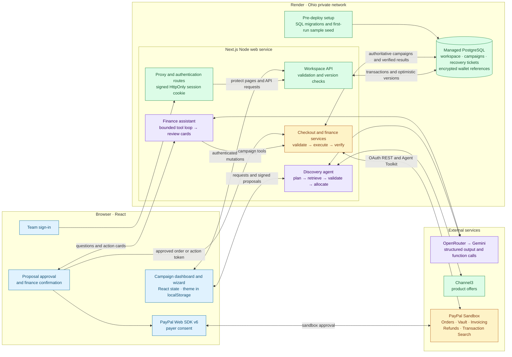

# Prova system architecture

Deployment instructions: [Render + PostgreSQL setup](docs/render-deployment.md). The app now uses a shared database workspace and server-verified demo login.

Prova uses AI to plan disaster relief purchases and help operators manage campaign finances. Both agents use OpenRouter and Gemini, with different roles for the model in each workflow.

- **Supply discovery agent.** Given a request like “supply 200 people after a flood,” the model plans catalog searches, selects from retrieved products, and proposes quantities and reasons. The server validates the model’s structured output against Channel3 offers and calculates quantities that fit the budget. [Discovery workflow](#supply-discovery-agent)
- **Finance assistant.** Given a request like “prepare a $20 refund for this purchase,” the model chooses which campaign tools to call, uses the returned PayPal data, and prepares an action for review. The user confirms the action before the server sends a financial write to PayPal. [Finance workflow](#finance-assistant-and-approval-boundary)

## Custom TypeScript agent orchestration

Prova implements its agent orchestration in TypeScript behind two Next.js API routes. Discovery uses a pipeline defined in code. The server alternates structured model calls with catalog search, validates the returned product references, and calculates quantities. Finance uses a bounded tool loop. The model chooses a campaign function, the server runs it, and the result goes back to the model for its next decision. Checkout and financial writes stay in server services that run after user approval.

| Agent | Primary model via OpenRouter | Fallback model via Gemini API |
| --- | --- | --- |
| Supply discovery | NVIDIA Nemotron, `nvidia/nemotron-3.5-super-vl:free` | Gemini Flash, `gemini-3.5-flash` |
| Finance assistant | NVIDIA Nemotron, `nvidia/nemotron-3.5-super-vl:free` | Gemini Flash, `gemini-3.5-flash` |

These are the default model IDs sent by the application. Both agents read `OPENROUTER_MODEL` and `GEMINI_MODEL` for overrides. [Discovery provider calls](lib/server/discovery.ts) · [Finance provider calls](lib/server/finance-agent.ts)

### OpenRouter to Gemini fallback

Each discovery run and finance message starts on OpenRouter. The shared retry helper allows up to three attempts per model request, with waits of one and two seconds. If OpenRouter exhausts its attempts, the server switches to Gemini for the rest of that run or message. Discovery can also rerun on Gemini if OpenRouter returns unusable search planning or its product selection still fails validation after repair. [Retry helper](lib/server/ai-retry.ts) · [Discovery fallback](lib/server/discovery.ts)

If discovery still cannot get usable AI output, it can return a labeled mock proposal or preserve the existing proposal and report that the revision was unapplied. If the finance model request fails on both providers, the assistant directs the user to the guided finance controls.

## Supply discovery agent

The [discovery agent](lib/server/discovery.ts) runs a server-directed workflow behind `POST /api/discovery`. The route streams newline-delimited JSON so the wizard can show progress, retries and the final proposal as they arrive. The same agent handles initial proposals and revisions. For a new proposal it asks the model to plan searches and rank product choices. For a revision it asks the model for targeted edits, while server code owns catalog access, validation and budget enforcement.

1. **Plan and retrieve.** The model interprets the disaster, population and duration and generates up to six search queries. The server searches Channel3 in batches of three, filters to eligible priced USD offers, and ranks preferred suppliers ahead of other eligible offers. Bulk availability and delivery estimates remain unverified.
2. **Ground the selection.** The server gives the model short references to catalog candidates. The model selects products and proposes relative quantities and explanations. The server maps references back to catalog records, rejects invalid selections, and gives the model one repair attempt with the validation error and previous response.
3. **Allocate in code.** The [budget allocator](lib/server/budget-allocation.ts) scales quantities and fills spare capacity with whole units of selected products while respecting the ceiling in integer cents, including estimated 5% shipping and 8% tax. New live proposals require at least four distinct products. The server signs the price snapshot with the budget and catalog records for checkout and expires it after 24 hours.
4. **Revise selectively.** On revision, the server verifies the prior snapshot and applies explicit add, update or remove operations. Unrelated products retain their quantities and the resulting proposal must still fit the budget.

The mock label follows a fallback proposal into checkout and receipts.

## PayPal Developer Platform
I had a lot of fun using the platform. I'd never explored PayPal's sandbox or developer features before (or fintech platforms in general), and I was impressed by how powerful they are.

Prova uses the PayPal Web SDK v6 for payer interaction, the PayPal Agent Toolkit for server-side operations, and direct REST calls for Vault and Orders v2 checkout. All three run against PayPal Sandbox.

### Sandbox OAuth and the PayPal Agent Toolkit

The REST adapter exchanges the server-side client ID and secret at `POST /v1/oauth2/token` using the client credentials grant. It sends the resulting bearer token to the Sandbox API and attaches a `PayPal-Request-Id` to POST requests. The Toolkit adapter uses `@paypal/agent-toolkit/openai` in Sandbox mode for finance tools such as invoices, refunds and reporting. Checkout creates, retrieves and captures Orders v2 directly through the REST adapter. Prova’s finance assistant calls narrower application functions that keep payment writes behind user confirmation. [PayPal adapter](lib/server/paypal.ts)

### PayPal Web SDK v6 and Orders v2

The browser initializes the Sandbox SDK with the public client ID and the `paypal-payments` component. It checks USD payment eligibility with `findEligibleMethods` and opens a modal with `createPayPalOneTimePaymentSession`. The checkout flow also retains a Sandbox approval link for redirect and recovery. [Browser SDK](lib/paypal-client.ts) · [Checkout wizard](components/wizard/step-checkout.tsx)

The server reconstructs the cart from signed catalog prices, checks the budget, and binds the order ID, campaign, approved items and total to a signed payment ticket. Both one-time and saved-wallet purchases use `POST /v2/checkout/orders`, with a stable request ID committed to PostgreSQL before the external call. Saved-wallet requests include the PayPal `vault_id` and charge breakdown. PayPal can require additional payer approval on that path. [Checkout service](lib/server/checkout.ts)

After approval, `GET /v2/checkout/orders/{id}` retrieves the order and `POST /v2/checkout/orders/{id}/capture` captures an approved order using a stable capture request ID. The server retrieves the order again after the capture attempt, including after a timeout. It issues a receipt only when the order and capture are completed and the capture matches the exact approved USD amount. PostgreSQL retains the pending checkout ticket across browsers and server restarts. The server commits the verified receipt and marks the attempt completed in one database transaction; repeated capture requests return the saved receipt. [Checkout service](lib/server/checkout.ts) · [Checkout wizard](components/wizard/step-checkout.tsx)

### Vault API and Payment Method Tokens v3

1. **Create a setup token.** Prova calls `POST /v3/vault/setup-tokens` for a PayPal wallet and binds the setup ID to an expiring signed ticket.
2. **Obtain and verify consent.** The browser opens `createPayPalSavePaymentSession` in a modal. The server calls `GET /v3/vault/setup-tokens/{id}` and requires an approved setup before proceeding.
3. **Exchange the setup token.** Prova calls `POST /v3/vault/payment-tokens` with the approved setup token and a request ID derived from its ID. It persists the encrypted shared Sandbox wallet reference in PostgreSQL and also sets an HttpOnly wallet cookie. Shared checkout reads the database reference. Checkout uses the token on a later purchase after proposal approval.
4. **Revoke a saved wallet.** Removing the account calls `DELETE /v3/vault/payment-tokens/{id}` and clears the database wallet reference and browser wallet cookie.

[Vault service](lib/server/vault.ts) · [Organization settings](components/settings-dialog.tsx) · [PayPal consent return](app/paypal/save/route.ts)

### Invoicing, refunds and transaction reporting

| PayPal capability | Toolkit operations | How Prova uses it |
| --- | --- | --- |
| Invoicing | `create_invoice`, `send_invoice`, `get_invoice`, `generate_invoice_qr_code` | Creates a sponsor invoice for selected merchandise and estimated charges, persists the draft reference, and then publishes it. The server retrieves the payment link and generates a QR code. Sponsor email is opt-in and merchant notifications are suppressed. Refreshing a published invoice can recover its status or QR code without resending email. Verified receipts from sponsors are tracked separately from the purchasing budget. |
| Payments and refunds | `create_refund`, `get_refund` | Revalidates the original capture and remaining refundable amount, then submits an exact partial refund or the full remaining amount after confirmation. Retrieves refund details to verify amount and status. Only completed refunds reduce campaign spending. |
| Transaction Search | `list_transactions` | Supplements reconciliation of purchases, refunds and invoices. Object status comes from the corresponding PayPal order, refund or invoice lookup, so a delayed or unavailable reporting entry does not determine payment status. |

[Finance service](lib/server/finance.ts) · [Invoice QR handling](lib/server/invoice-qr.ts)

## Finance assistant and approval boundary

The finance assistant is a conversational agent behind `POST /api/finance/chat`. The server gives it campaign context and exposes six functions through OpenRouter or Gemini’s native function-calling format. Unlike discovery, where server code determines the sequence of model and search calls, the finance model chooses which permitted functions to call and can use their results to decide what to do next. Each message is capped at four model rounds and eight tool executions. [Finance assistant](lib/server/finance-agent.ts)

| Function | What the server provides |
| --- | --- |
| `order_status` | Verified order and capture details for a campaign purchase. |
| `invoice_status` | PayPal status for a campaign funding invoice. |
| `refund_status` | PayPal status for a campaign purchase refund. |
| `reconcile_campaign` | Checks the campaign’s payment, invoice and refund references against PayPal. |
| `prepare_invoice` | Validates the funding source and selected items, then prepares a review card with the amount and any requested sponsor notification. |
| `prepare_refund` | Checks the original capture and available refundable amount, then prepares a review card for the requested refund. |

Preparation produces a signed action token that binds the campaign, source, amount, operation ID and applicable invoice preferences for 15 minutes. The user confirms the card through a separate request. The workspace API persists pending operation metadata in PostgreSQL before confirmation, and the server revalidates the inputs and reuses PayPal request IDs so retries can recover an existing invoice or refund. Guided finance controls use the same confirmation path and remain available during a model outage. [Finance service](lib/server/finance.ts)

## Shared workspace storage

PostgreSQL stores settings, folders, campaign JSON documents, verified finance results, encrypted saved-wallet references, and checkout recovery records. Server routes load authoritative campaigns and serialize updates with transactions. Browser saves use record versions to reject conflicting edits. Only theme preferences remain in local storage. Run `pnpm db:setup` to migrate and seed an empty workspace; rerunning it preserves edits.

## Authentication and deployment

One team email and password are configured through server environment variables. Sign-in verifies them on the server and creates an expiring signed HttpOnly session cookie. The Next.js proxy protects dashboard, campaign, PayPal and API routes and checks the origin of browser mutations. This hackathon workspace has one shared identity; it does not implement individual accounts or organization isolation.

Render hosts the Next.js Node service and managed PostgreSQL in the same region. The service connects using a server-only internal DATABASE_URL. API credentials and SESSION_SECRET remain in Render environment variables. APP_URL, or Render's automatic public URL, supplies the origin for HTTPS callbacks and request checks.

The pre-deploy command applies versioned SQL migrations and seeds only an uninitialized workspace. Samples include a draft campaign, a proposal, and a synthetic completed purchase. Sample campaigns cannot initiate PayPal operations; create a new campaign for sandbox tools. Redeployments preserve edits. Existing browser workspaces are not automatically imported.

See [deployment steps, environment variables, local setup, and demo reset](docs/render-deployment.md) and the [Render Blueprint](render.yaml).

## Verification

Run `pnpm typecheck`, `pnpm test:db`, and `pnpm build`. Database integration tests use embedded PostgreSQL (PGlite) and mocked PayPal HTTP responses to verify seed preservation, conflict rejection, retry recovery, capture persistence, authentication, and Render origin handling. A live deployment and sandbox payment still require the smoke test in the deployment guide.

## License

This project is licensed under the MIT License - see the LICENSE file in the repository for more details.
