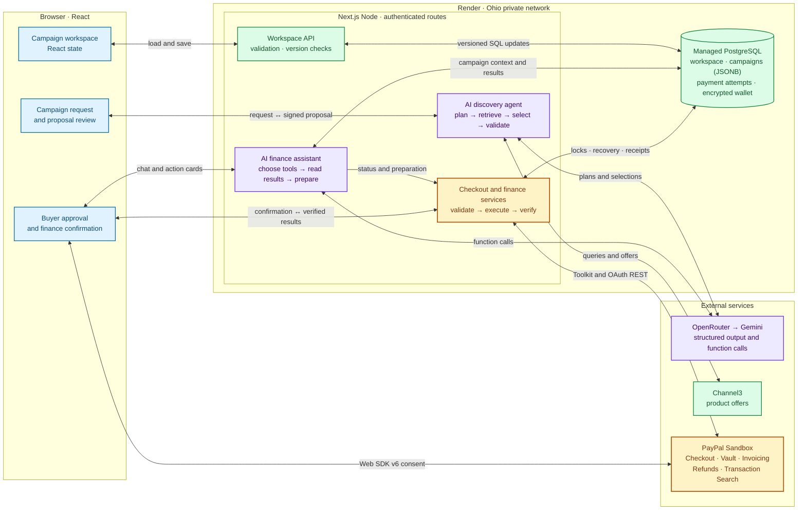

# Prova system architecture

Prova uses AI to plan disaster relief purchases and help operators manage campaign finances. Both agents use OpenRouter and Gemini, with different roles for the model in each workflow. Prova uses the PayPal Developer Platform to turn approved supply plans into Sandbox payments and help operators request sponsor funding, issue refunds and verify campaign finances.

- **Supply discovery agent.** Given a request like “supply 200 people after a flood,” the model plans catalog searches, selects from retrieved products, and proposes quantities and reasons. The server validates the model’s structured output against Channel3 offers and calculates quantities that fit the budget. [Discovery workflow](#supply-discovery-agent)
- **Finance assistant.** Given a request like “prepare a $20 refund for this purchase,” the model chooses which campaign tools to call, uses the returned PayPal data, and prepares an action for review. The user confirms the action before the server sends a financial write to PayPal. [Finance workflow](#finance-assistant-and-approval-boundary)

## Shared PostgreSQL workspace

PostgreSQL is the source of truth for the shared campaign workspace. The browser loads it through `GET /api/workspace` and queues edits through `POST /api/workspace`; React context holds the current view. Only the theme preference remains in `localStorage`. Discovery returns signed proposals to the browser, which saves them through the workspace API before checkout. Finance and checkout routes load authoritative campaigns from SQL rather than trusting campaign records submitted by the browser. [Browser store](lib/store.tsx) · [Workspace service](lib/server/workspace.ts)

| Table | Stored data |
| --- | --- |
| `workspace` | Organization settings and folders as JSONB, a workspace version, the encrypted shared PayPal wallet reference, and its one-time bootstrap flag. |
| `campaigns` | Campaign JSONB documents containing requests, attachments, proposals, purchases, audit entries, finance messages, pending operations, invoices, refunds and verification results, with a separate record version. |
| `payment_attempts` | One checkout attempt per campaign, its stable PayPal request ID, pending order and signed recovery ticket in JSONB, and a completion flag. |
| `paypal_webhook_events` | Signature-verified webhook inbox with a unique event ID, original payload, processing attempts, last error and completion timestamp. |

Workspace mutations use SQL transactions and reject stale campaign or settings versions. Campaign payment and finance operations lock the campaign row with `SELECT ... FOR UPDATE`, then save server-verified results in the same transaction. Browser finance saves are limited to messages and operation metadata. Campaign deletion is a soft delete, preserving records needed for pending payment recovery. [Database transactions](lib/server/db.ts) · [Schema migrations](db/migrations)

The [Render Blueprint](render.yaml) provisions the Node web service and managed PostgreSQL in Ohio using an internal `DATABASE_URL`. Its pre-deploy command runs SQL migrations and seeds an uninitialized workspace; later deployments preserve edits. Sample campaigns contain synthetic data and cannot initiate PayPal operations. An optional encrypted `PAYPAL_DEFAULT_VAULT_WALLET` imports an already-approved sandbox wallet once, preserving deliberate disconnects on subsequent deployments. [Setup and deployment](docs/render-deployment.md)

One team email and password are configured through `DEMO_EMAIL` and `DEMO_PASSWORD`. Sign-in issues a signed HttpOnly session cookie valid for 24 hours. The Next.js proxy checks sessions and the origin of browser mutations. API rate limits are shared per server process: 120 requests per minute overall, 10 login attempts, and 10 discovery/finance-chat requests combined; excess requests receive `429` with `Retry-After`. These counters reset on restart and are independent across instances. The app has one shared identity, without individual accounts or organization isolation. [Proxy](proxy.ts) · [Sessions](lib/server/session.ts) · [Rate limits](lib/server/rate-limit.ts)

## Custom TypeScript agent orchestration

Prova implements its agent orchestration in TypeScript behind two Next.js API routes. Discovery uses a pipeline defined in code. The server alternates structured model calls with catalog search, validates the returned product references, and calculates quantities. Finance uses a bounded tool loop. The model chooses a campaign function, the server runs it, and the result goes back to the model for its next decision. Checkout and financial writes stay in server services that run after user approval.

| Agent | Primary model via OpenRouter | Fallback model via Gemini API |
| --- | --- | --- |
| Supply discovery | NVIDIA Nemotron, `nvidia/nemotron-3.5-super-vl:free` | Gemini Flash, `gemini-3.5-flash` |
| Finance assistant | NVIDIA Nemotron, `nvidia/nemotron-3.5-super-vl:free` | Gemini Flash, `gemini-3.5-flash` |

These are the default model IDs sent by the application. Both agents read `OPENROUTER_MODEL` and `GEMINI_MODEL` for overrides. [Discovery provider calls](lib/server/discovery.ts) · [Finance provider calls](lib/server/finance-agent.ts)

### OpenRouter to Gemini fallback

Each discovery run and finance message starts on OpenRouter. The shared retry helper allows up to three attempts per model request, with waits of one and two seconds. If OpenRouter exhausts its attempts, the server switches to Gemini for the rest of that run or message. Discovery can also rerun on Gemini if OpenRouter returns unusable search planning or its product selection still fails validation after repair. [Retry helper](lib/server/ai-retry.ts) · [Discovery fallback](lib/server/discovery.ts)

## Supply discovery agent

The [discovery agent](lib/server/discovery.ts) runs a server-directed workflow behind `POST /api/discovery`. The route streams newline-delimited JSON so the wizard can show progress, retries and the final proposal as they arrive. The same agent handles initial proposals and revisions. For a new proposal it asks the model to plan searches and rank product choices. For a revision it asks the model for targeted edits, while server code owns catalog access, validation and budget enforcement.

1. **Plan and retrieve.** The model interprets the disaster, population and duration and generates up to six search queries. The server searches Channel3 in batches of three, filters to eligible priced USD offers, and ranks preferred suppliers ahead of other eligible offers. Bulk availability and delivery estimates remain unverified.
2. **Ground the selection.** The server gives the model short references to catalog candidates. The model selects products and proposes relative quantities and explanations. The server maps references back to catalog records, rejects invalid initial selections, and gives the model one repair attempt with the validation error and previous response.
3. **Allocate in code.** The [budget allocator](lib/server/budget-allocation.ts) scales quantities and fills spare capacity with whole units of selected products while respecting the ceiling in integer cents, including estimated 5% shipping and 8% tax. New live proposals require at least four distinct products. The server signs the price snapshot with the budget and catalog records for checkout and expires it after 24 hours.
4. **Revise selectively.** On revision, the server verifies the prior snapshot and applies explicit add, update or remove operations. Unrelated products retain their quantities and the resulting proposal must still fit the budget.

## PayPal Developer Platform
I had a lot of fun using the platform. I'd never explored PayPal's sandbox or developer features before (or fintech platforms in general), and I was impressed by how powerful they are.

Prova uses the PayPal Web SDK v6 for payer interaction, the PayPal Agent Toolkit for campaign finance operations, and direct REST calls for Vault and Orders v2 checkout. All three run against PayPal Sandbox; retailer fulfillment is simulated.

### Sandbox OAuth and the PayPal Agent Toolkit

The REST adapter exchanges the server-side client ID and secret at `POST /v1/oauth2/token` using the client credentials grant. It sends the resulting bearer token to the Sandbox API and attaches a `PayPal-Request-Id` to POST requests. The Toolkit adapter uses `@paypal/agent-toolkit/openai` in Sandbox mode for finance order lookups, invoices, refunds and reporting. Checkout creates, retrieves and captures Orders v2 through the REST adapter. Prova’s finance assistant calls narrower application functions that keep payment writes behind user confirmation. [PayPal adapter](lib/server/paypal.ts)

### PayPal Web SDK v6 and Orders v2

The browser initializes the Sandbox SDK with the public client ID and the `paypal-payments` component. It checks USD payment eligibility with `findEligibleMethods` and opens a modal with `createPayPalOneTimePaymentSession`. The checkout flow also retains a Sandbox approval link for redirect and recovery. [Browser SDK](lib/paypal-client.ts) · [Checkout wizard](components/wizard/step-checkout.tsx)

The server reconstructs the cart from signed catalog prices, checks the proposal budget and the campaign’s remaining funds, and binds the order ID, campaign, approved items and total to a signed payment ticket. Both one-time and saved-wallet purchases use `POST /v2/checkout/orders`, with a stable request ID committed to PostgreSQL before the external call. Saved-wallet requests include the PayPal `vault_id` and charge breakdown. PayPal can require additional payer approval on that path. [Checkout service](lib/server/checkout.ts) · [Checkout creation route](app/api/checkout/create/route.ts)

After approval, `GET /v2/checkout/orders/{id}` retrieves the order and `POST /v2/checkout/orders/{id}/capture` captures an approved order with a stable capture request ID. The server retrieves the order again after the capture attempt, including after a timeout. It issues a receipt only when the order and capture are completed and the capture matches the exact approved USD amount. PostgreSQL retains the pending order and signed recovery ticket across browsers and server restarts. The server saves the verified receipt and marks the attempt completed in one SQL transaction; repeated capture requests return the saved receipt. [Checkout service](lib/server/checkout.ts) · [Capture route](app/api/checkout/capture/route.ts) · [Checkout wizard](components/wizard/step-checkout.tsx)

### Vault API and Payment Method Tokens v3

1. **Create a setup token.** Prova calls `POST /v3/vault/setup-tokens` for a PayPal wallet and binds the setup ID to an expiring signed ticket.
2. **Obtain and verify consent.** The browser opens `createPayPalSavePaymentSession` in a modal. The server calls `GET /v3/vault/setup-tokens/{id}` and requires an approved setup before proceeding.
3. **Exchange the setup token.** Prova calls `POST /v3/vault/payment-tokens` with the approved setup token and a request ID derived from its ID. It encrypts the resulting wallet reference in PostgreSQL and an HttpOnly cookie. Shared checkout reads the database reference and uses the token on a later purchase after proposal approval.
4. **Revoke a saved wallet.** Removing the account calls `DELETE /v3/vault/payment-tokens/{id}` and clears the database wallet reference and browser wallet cookie.

[Vault service](lib/server/vault.ts) · [Organization settings](components/settings-dialog.tsx) · [PayPal consent return](app/paypal/save/route.ts)

### Invoicing, refunds and transaction reporting

| PayPal capability | Toolkit operations | How Prova uses it |
| --- | --- | --- |
| Invoicing | `create_invoice`, `send_invoice`, `get_invoice`, `generate_invoice_qr_code` | Creates a sponsor invoice for selected merchandise and estimated charges, persists the draft reference in PostgreSQL, and then publishes it. The server retrieves the payment link and generates a QR code. Sponsor email is opt-in and merchant notifications are suppressed. Status refreshes update saved records; retrying publication for an already-published invoice can recover its QR code without resending email. Verified receipts from sponsors are tracked separately from the purchasing budget. |
| Payments and refunds | `create_refund`, `get_refund` | Revalidates the original capture and remaining refundable amount, then submits an exact partial refund or the full remaining amount after confirmation. Retrieves refund details to verify amount and status. Only completed refunds reduce campaign spending. |
| Transaction Search | `list_transactions` | Supplements reconciliation of purchases, refunds and invoices. Object status comes from the corresponding PayPal order, refund or invoice lookup, so a delayed or unavailable reporting entry does not determine payment status. |

[Finance service](lib/server/finance.ts) · [Invoice QR handling](lib/server/invoice-qr.ts)

### PayPal webhooks and missed-event recovery

PayPal webhooks refresh completed captures, refunds and sponsor invoice payments. Prova verifies each signature and retrieves authoritative details from PayPal before updating financial records. Unique event IDs prevent duplicate processing, and database transactions commit financial updates and event completion together.

Failed events remain retryable. Manual reconciliation checks PayPal for missed updates and can recover completed purchases when the browser callback is lost. Pending invoice payments do not count as received funding.

[Webhook handler](lib/server/paypal-webhooks.ts) · [Reconciliation](scripts/paypal-reconcile.ts)

## Finance assistant and approval boundary

The finance assistant is a conversational agent behind `POST /api/finance/chat`. The server gives it campaign context and exposes six functions through OpenRouter or Gemini’s native function-calling format. Unlike discovery, where server code determines the sequence of model and search calls, the finance model chooses which permitted functions to call and can use their results to decide what to do next. Each message is capped at four model rounds and eight tool executions. [Finance assistant](lib/server/finance-agent.ts)

| Function | What the server provides |
| --- | --- |
| `order_status` | Verified order and capture details for a campaign purchase. |
| `invoice_status` | PayPal status for a campaign funding invoice. |
| `refund_status` | PayPal status for a campaign purchase refund. |
| `reconcile_campaign` | Checks the campaign’s payment, invoice and refund references against PayPal. |
| `prepare_invoice` | Validates the funding source and selected items, then prepares a review card with the amount and any requested sponsor notification. |
| `prepare_refund` | Checks the original capture and available refundable amount, then prepares a review card for the requested refund. |

Preparation produces a signed action token that binds the campaign, source, amount, operation ID and applicable invoice preferences for 15 minutes. The user confirms the card through a separate request. Before confirmation, the browser saves pending operation metadata to PostgreSQL through the workspace API. The finance route loads and locks the campaign, revalidates the inputs, reuses PayPal request IDs so retries can recover an existing invoice or refund, and persists the result. Assistant status checks and reconciliation results are also saved by server routes. Guided finance controls use the same confirmation path and remain available during a model outage. [Finance service](lib/server/finance.ts) · [Finance route](app/api/finance/route.ts) · [Assistant route](app/api/finance/chat/route.ts)

## License

This project is licensed under the MIT License - see the LICENSE file in the repository for more details.
